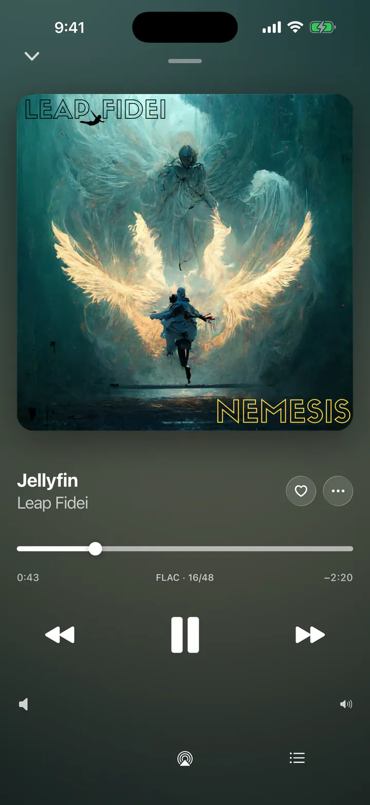
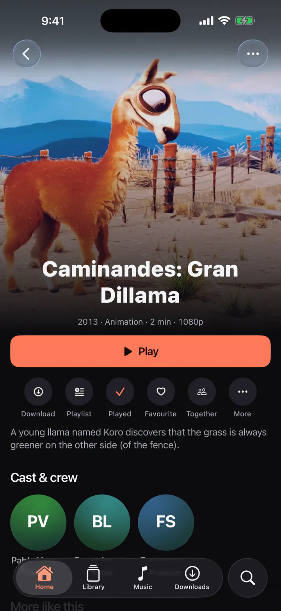
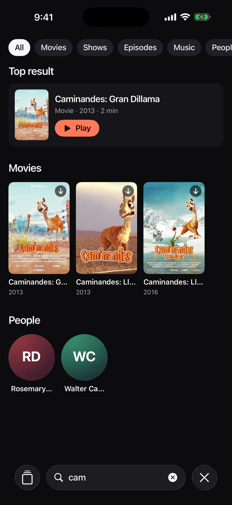

<p align="center">
  
</p>

<h1 align="center">Zoggyfin</h1>

<p align="center">
  A fast, clear Jellyfin client for iPhone, iPad, Mac and the web, with watch and listen together.
</p>

<p align="center">
  <a href="LICENSE"></a>
  <a href="https://github.com/zog-tech/zoggyfin/actions/workflows/ci.yml"></a>
  
  
</p>

<p align="center">
  <a href="https://zoggyfin.zog-tech.com">Website</a> ·
  <a href="https://testflight.apple.com/join/qRFABNBJ">TestFlight</a> ·
  <a href="https://releases.zog-tech.com/zoggyfin/latest/Zoggyfin-arm64.dmg">Mac download</a> ·
  <a href="CONTRIBUTING.md">Contribute</a>
</p>

<p align="center">
  
  
  
</p>

The screenshots show demo content from the public Jellyfin demo server.

Zoggyfin is an open-source client for [Jellyfin](https://jellyfin.org) media servers.
The goal is a client that is fast, stable and clear.
It runs on iPhone, iPad and the web, and on Apple silicon Macs as a desktop app with libmpv.
Android is coming soon.

Zoggyfin is not affiliated with the Jellyfin project.

## Features

- **Video player.** Direct play when the device can open the file, HLS when it cannot. It has
  trickplay previews, chapters, audio and subtitle tracks, Skip Intro, Picture in Picture,
  AirPlay and a mini player.
- **Music player.** Background audio, a queue, synced lyrics, Instant Mix, a sleep timer and
  a long-form mode for audiobooks.
- **Downloads for offline play.** Movies, episodes, songs, albums and playlists download in
  the background. The app plays them with no server and reports progress when the server is back.
- **Many servers and accounts.** Save several servers with several users each. A server can
  have internal and external addresses, and the app picks the first one that answers.
- **Server discovery.** The first screen finds Jellyfin servers on the local network.
- **Watch and listen together.** Use Jellyfin SyncPlay groups over the internet, or start a
  nearby session with no internet and no server.
- **Invites.** An administrator adds a person and sends one link or QR code.
- **Admin panel.** Dashboard, now playing, users, libraries, tasks, activity, devices and logs
  for server administrators.
- **Extensions.** Add features for your own setup with a JSON manifest. No extension code runs in
  the app. See [docs/extensions.md](docs/extensions.md).
- **Search, playlists and a design system.** One look on every platform, with a dark and a light
  theme and Arabic text rules.

The [feature details](#feature-details) below describe each part.

### Platforms

| Platform | State |
|---|---|
| iPhone and iPad | Beta on TestFlight |
| Mac (Apple silicon, macOS 13 or later) | Signed and notarized DMG, with automatic updates |
| Web | Build it yourself and host it (see below) |
| Android | Coming soon |

Every feature is meant to work on every platform. Where a feature is not on a platform yet,
the feature details say so (for example, downloads are not on the web).

## Download

- **iPhone and iPad:** join the beta on [TestFlight](https://testflight.apple.com/join/qRFABNBJ).
- **Mac** (Apple silicon, macOS 13 or later): [Zoggyfin-arm64.dmg](https://releases.zog-tech.com/zoggyfin/latest/Zoggyfin-arm64.dmg).
  The app is signed and notarized, and it updates itself. All versions and notes are on
  [zoggyfin.zog-tech.com/download](https://zoggyfin.zog-tech.com/download).
- **Android:** coming soon.
- **Website:** [zoggyfin.zog-tech.com](https://zoggyfin.zog-tech.com).

You need a Jellyfin server (10.11 or later) and a user account on it.
To try the app first, use the public demo server `https://demo.jellyfin.org/stable`,
user name `demo`, no password.

## Feature details

Zoggyfin is in early development. The sections below describe what exists today, in the order it was built.

Phase 1 ("Foundation"):

- Sign in with a server address and a username and password, or with Quick Connect.
- Home: Continue Watching, Next Up, Because you watched (movie recommendations), Continue Listening,
  Short on time (unwatched movies of 100 minutes or less), Recently Added per library, and a genre of the day.
- Library: library grids with sort and filters, shows to seasons to episodes, collections.
- Music: Albums, Artists, Playlists, Songs and Genres in a swipeable pager.
- Item pages for movies, shows, seasons, episodes, albums, artists, people and playlists.
- Search, with results grouped by type and recent searches.
- Every tile has a picture: server art when it exists, generated art when it does not.
- A persisted query cache, so a cold start shows the last content at once.

Phase 2 ("Video") adds the video player:

- The server direct-plays what the device can open (mp4, m4v, mov with H.264, HEVC and,
  with a hardware decoder, AV1) and sends HLS for the rest. The device profile is in
  `src/player/device-profile.ts`.
- Full-screen player with play/pause, skip back and forward, a scrubber with trickplay
  preview and chapter marks, audio and subtitle tracks, quality, playback speed,
  Skip Intro / Skip Credits, a next-episode countdown, double-tap to seek and swipe down
  to minimize.
- Picture in Picture, AirPlay, background audio, lock-screen controls, a mini player.
- Resume and Start Over on item pages. Progress goes to the server every 10 seconds and
  on pause, seek and stop.
- Keyboard: Space play/pause, ←/→ seek, Shift+←/→ 30 s, F full screen (web), M mute,
  C subtitles, Esc close. On iPad and Mac this works with a hardware keyboard.

Phase 2b ("Platform base and restyle"):

- Every screen follows the design system in [docs/design](docs/design/): the Ember accent on
  graphite, a light theme that follows the system (Settings, Appearance: System, Dark or
  Light), one icon set (SF Symbols on Apple platforms, Lucide on the web), generated art for
  items without a picture, skeletons while loading and Arabic text rules.
- Item pages pick their hero from the artwork: a tall backdrop, a wide 16:9 image (videos with
  only a wide thumbnail), square album art or a circle for people.
- The project builds on `react-native-tvos` (aliased as `react-native`) with
  `@react-native-tvos/config-tv`. Phone, tablet and web builds are unchanged. `EXPO_TV=1`
  makes prebuild generate TV targets with the 10-foot layout (side menu, remote focus); see
  [Android TV app](#android-tv-app-google-tv-fire-tv).

Phase 3 ("Music and audio"):

- Audio plays with expo-audio through the server's universal endpoint, in the background and
  on the lock screen (artwork, play/pause, next/previous, seek). Interruptions and unplugged
  headphones pause. The queue lives in JavaScript; the native playlist holds the current and
  the next track, so the next track starts without a reload.
- Queue: play now, play next, add to queue, drag to reorder, swipe to remove, clear, shuffle
  and repeat (off, all, one). The queue and the position come back after a restart.
- Full player (always dark): art-tinted background, scrubber, volume, AirPlay, a queue panel,
  synced or plain lyrics when the server has them, favourite, go to album or artist. On wide
  windows the queue or lyrics sit beside the player.
- Long-form mode for audiobooks, long tracks and spoken-word albums: resume per item
  ("Resumes where you left off"), speed 0.75–2×, 15/30 s skips, a sleep timer (minutes or end
  of track) and chapters. Positions are kept on the device and reported to the server.
- Instant Mix from a song, album, artist or genre. Music tab: sort and favourites filter per
  tab, Recently played and Most played rows, album, artist and genre pages with Play, Shuffle
  and Mix. Audiobook libraries open in the same browser.
- Web: Media Session controls and Space/←/→ keys. Noto Sans Arabic is bundled for the web.

Phase 4 ("Downloads and playlists"):

- Downloads (iOS and iPadOS) use a background URL session through
  @kesha-antonov/react-native-background-downloader. Two files download at a time. Downloads
  continue when the app is in the background, and the app finds them again after a restart.
  Each download goes through a tested state machine: queued, downloading, paused, then
  completed, failed (with retry and backoff) or cancelled.
- Movies, episodes, seasons, series, songs, albums and playlists can be downloaded. A video
  downloads as the original file when the device can play it directly. Otherwise the server
  makes a copy at the "Download quality" setting (Original, 1080p, 720p or 480p). Images,
  subtitles, lyrics and item metadata download with the media.
- Files are in `Documents/downloads/<item id>/` and are not in iCloud backups. Records are
  in MMKV with a schema version and migrations.
- Downloads tab: in-progress rows with progress, speed, time left, pause, resume, cancel and
  retry. Downloaded items are grouped by show or album, with sizes, swipe to delete and a
  storage bar. The tab shows a badge while downloads run.
- Offline mode: the app plays downloads from the device first. A banner shows when the server
  is unreachable. Home shows downloads first, and search looks in downloads. Playback progress
  goes into an outbox and goes to the server when the server is reachable again.
- Playlists: "Add to playlist" from every action menu, the full player and the queue (Save),
  with "New playlist" in the same sheet. Playlist pages: rename, delete, drag to reorder,
  swipe or tap the bin to remove, play, shuffle and download. Changes show at once and roll
  back if the server refuses them.
- Web: playlists work fully. Downloads are not on the web.
- Development builds have "Simulate no server" in Settings to test offline mode.

Servers and accounts:

- Save many servers, each with one or more users. The avatar button on Home opens the
  account switcher: one tap on a user switches to that server and user.
- A server has internal and external addresses. The app checks all of them at the same
  time and uses the first one in your order that answers as the same server (it compares
  the server Id). It checks again at start, on foreground, on a network change and after
  a failed request. Modes: Automatic, Always internal, Always external. An optional Wi-Fi
  rule picks the internal address on named Wi-Fi networks (iOS and Android).
- Settings, Servers: add, edit, order and remove addresses, "Find addresses", the
  connection status ("Connected through Home network (internal)") with "Check again",
  users, Add user, and Remove server (with its downloads, if you want).
- Each account has its own cache. The Downloads tab shows the downloads of other servers
  under "Other servers".
- An install with one saved account moves to the new format at the first start, with no
  new sign-in. See "Server addresses" in the design.

Invites:

- An administrator adds a person in a few taps: Settings, Servers, <server>, Invite
  someone. Type a name and tap Send. The app makes the Jellyfin user with a one-time
  password and opens the share sheet with a link. A QR code shows the same link.
- The link is `https://zoggyfin.zog-tech.com/join#…`. The invite is in the fragment, so
  no server log gets it. It has all useful addresses of the server (internet, Tailscale,
  VPN), so it works also when the server is reachable only over Tailscale or WireGuard.
- With the app, the link opens the app. Without the app, the page gives the right
  download and copies the invite; after the install, "Paste invite" on the first screen
  joins. The person sets an own password at once. See "Invites" in the design.

Desktop app (macOS on Apple Silicon):

- A Tauri 2 window around the web build, in [desktop/](desktop/). Video plays through libmpv:
  the original file plays directly (MKV, HEVC, AV1, DTS, ASS and PGS subtitles), with the
  Zoggyfin player controls over the video. Music uses the web audio engine.
- Downloads (the Downloads tab, resume after pause or restart, offline play through libmpv),
  Now Playing and the media keys for video.
- Standard Mac menus (⌘, Settings, ⌘F Search), a transparent title bar, and the window keeps
  its size and position.
- `pnpm desktop:dev` and `pnpm desktop:build`. Development needs `brew install mpv`.
- `pnpm desktop:release` builds an LGPL libmpv from source, puts it in the app, signs with
  Developer ID (hardened runtime) and makes a notarized DMG.
  See [desktop/README.md](desktop/README.md) for the libmpv licenses, signing and the notices.

Phase 5 ("Watch together"):

- A "Watch together" button in the video player and a "Together" action on video item pages
  open the session sheet. A "Together" indicator in the player shows the session; tap it to
  open the sheet.
- Nearby mode (iPhone, iPad and the Mac app; Android from its next build, not tested yet;
  no internet and no Jellyfin server needed):
  the host shares a downloaded video, album, playlist or audiobook from any saved server.
  People nearby see the session, ask to join, and the host accepts or declines. A guest
  plays its own download of the same item (same server and item Id) or streams the host's
  file. Everyone can play, pause, seek and change the speed (and, for audio, next, previous,
  shuffle and repeat), or the host turns on "Only the host controls". The group waits while
  a new member loads.
- The link: Bonjour (`_zgf-together._tcp`) and one TCP port per session. Apple devices
  connect directly with no router (peer-to-peer Wi-Fi); Android needs the same Wi-Fi or a
  hotspot, which the Android device makes. A join code (QR code or short text) works on
  Wi-Fi that hides devices from each other, for example in hotels and on planes.
- Drops: nobody pauses when a device drops. A guest comes back by itself for 2 minutes, or
  with "Rejoin" for 10 minutes after an app restart. When the host drops, the member that
  joined first and has the media becomes the host.
- Listen together: "Listen together" in the music player's ⋯ menu and on album and
  playlist pages. A "Together" indicator shows in the full and mini music players.
- Internet mode: Jellyfin SyncPlay groups on the signed-in server, on native and the web.
  Start a group with the current item or the audio queue, join a group, play, pause and
  seek for everyone, next and previous item of the group queue, leave.
- Sync: the host (nearby) or the server (SyncPlay) is the clock; each device measures its
  clock offset with ping/pong and corrects drift with small speed changes or a seek. On two
  simulators the median sync error was 2–11 ms for video and 5 ms for music; the Mac app
  as a guest had 38 ms (video) and 75 ms (music). See
  [docs/specs/watch-together-spike.md](docs/specs/watch-together-spike.md).
- Not on TV. The web has SyncPlay only.

Offline use (no sign-in needed):

- With no account signed in, or when the server does not answer, the app offers
  "Downloads" (when a download is on the device, from any server) and
  "Join a nearby session" (iPhone, iPad, Mac app). They are on the sign-in screen and in the
  Home offline banner. Downloads play from the device; play one and use "Watch together"
  to host a nearby session. Signing out keeps the downloads.
- When the host ends a session, a guest that streams the host's file leaves the player; a
  guest with its own download keeps its place. Toasts show above the full-screen players.

Admin panel (administrators of a server only):

- Settings, Admin (one row per server), or the shield on the server row. iPad, the Mac app
  and wide web windows show the sections on the left and the section on the right.
- Dashboard: server name, version, operating system, "Restart pending", sessions, running
  tasks and storage per library folder (Jellyfin 10.11 and later).
- Now playing: who plays what, on which device and app, with progress, Direct Play, Direct
  Stream or Transcode (and why), and the bitrate. Message, pause or resume, stop and stop
  transcode. The list refreshes every 5 s while the screen is open.
- Users: last activity and last sign-in, admin and disabled marks. Per user: library access,
  downloads, remote access, transcoding, SyncPlay, the bitrate limit, the parental rating,
  enable or disable, a new password or no password, and delete (type the name to confirm).
  "Invite someone" opens the invite flow.
- Libraries (scan, refresh metadata), scheduled tasks (run now, stop, last and next run),
  the activity log (filters and paging), devices (remove signs a device out) and the server
  log files (a monospace viewer with search that loads large files in parts).
- Restart and shut down the server (type the server name to confirm). Plugins and
  transcoding settings stay in the web dashboard: "Open web dashboard".
- Development builds: Settings, Development, "Admin fixture data" (or `?adminFixtures=1` on
  the web) shows the panel with made-up data and sends no request to a server.

The design is in [docs/specs](docs/specs/) and [docs/design](docs/design/).

The native app includes a small local module, `modules/zoggyfin-native`, that reports
hardware decoders and hardware keyboard presses, draws the system volume slider and runs
the nearby transport for watch and listen together (Network.framework and Bluetooth LE on
Apple devices, `NsdManager`, Bluetooth LE and the local-only hotspot on Android, a range
server for the host's file and a loopback relay for Apple guests). The Mac app uses the
same Swift code through `desktop/src-tauri/swift/`.
It builds with the app.

## Server setup notes

### Remote access through a reverse proxy or a tunnel

Zoggyfin works with Jellyfin behind a reverse proxy or a tunnel (for example Cloudflare Tunnel,
Traefik, Caddy or nginx). Put the public address in the server's external address, and keep
the home address as the internal address. The app selects the correct one.

You do not have to change any Jellyfin setting for this. But without a change, Jellyfin sees
every request from the proxy as a request from the local network. Then:

- a user who is limited to the local network can sign in from the internet;
- the internet bitrate limit does not apply;
- the logs and the admin panel show the address of the proxy, not of the person.

To correct this, open **Dashboard > Networking** in Jellyfin:

1. Set **Known proxies** to the address that the proxy uses to connect to Jellyfin. For a proxy
   in Docker, this is the proxy container's address, or the Docker network gateway when Docker
   forwards the port.
2. Turn on **Allow remote connections to this server**. If it stays off, Jellyfin now blocks
   the internet users, because it sees their real addresses.
3. Restart Jellyfin.

Note: the Cloudflare terms limit large video traffic through its network. For a small
household this is usually not a problem. For heavy streaming, Tailscale or WireGuard is a
better choice, and Zoggyfin supports both.

## Build from source

You need Node 22 or later and pnpm 10. For iOS you also need Xcode.

```sh
pnpm install
pnpm expo run:ios        # builds the native app and starts it in the simulator
pnpm start               # starts Metro for an already installed development build
pnpm expo start --web    # runs the web app in a browser
```

The `ios/` and `android/` folders are generated (Expo CNG) and are not in git.

Checks:

```sh
pnpm typecheck
pnpm lint
pnpm test
```

### Web build

```sh
pnpm expo export --platform web
```

The `dist/` folder is a static site. A self-hosted build can carry an optional
`config.json` next to `index.html` to prefill the server address, for example
`{ "defaultServerUrl": "http://jellyfin.example.lan:8096" }`. It fills the address field
when no server is saved. See `public/config.example.json`. The Jellyfin server must allow
the web app's origin (CORS). A web app served over https cannot use http server addresses
(the browser blocks mixed content); the app shows a message for them.

### Desktop app (macOS)

You need Rust (stable) and Homebrew libmpv for development.

```sh
brew install mpv
pnpm install
pnpm expo start --web --port 8082   # Metro web, in one terminal
pnpm desktop:dev                    # the desktop app, in another terminal
```

`pnpm desktop:build` makes an app for testing. `pnpm desktop:release` builds an LGPL libmpv,
signs the app and makes a notarized DMG. The release needs signing keys that only the
maintainer has. See [desktop/README.md](desktop/README.md).

### Android TV app (Google TV, Fire TV)

Two EAS profiles make the TV app. Both set `EXPO_TV=1` and use the `tv` update channel.

| Profile | Output | Self-update |
|---|---|---|
| `tv` | APK for sideloading (the website) | On: `ZOGGYFIN_TV_SELF_UPDATE=1` adds `REQUEST_INSTALL_PACKAGES` and a FileProvider (`app.config.ts`) |
| `tv-play` | App bundle for Google Play | Off: no install permission, as Google Play requires |

The `tv` app reads `https://releases.zog-tech.com/zoggyfin/android-tv/latest.json` 10 s after
start and every 4 hours. When the feed has a higher `versionCode`, the update card offers the
new version. Every release keeps the version name of `app.json` (0.1.0, the runtime version of
over-the-air updates), so only the `versionCode` counts. The card shows both, for example
"0.1.0 (25)". "Install" downloads the APK to the app cache, checks its SHA-256, and opens the
system installer. The first time, Android asks to let Zoggyfin install apps: the card opens that
settings page. The updater runs only when the build's manifest has the install permission, so an
over-the-air update cannot turn it on in the Play build. A test build can read another feed with
`EXPO_PUBLIC_TV_UPDATE_URL=<https URL of a latest.json>`.

Release (maintainer): `pnpm tv:release` (`scripts/release-android-tv.sh`). It builds the `tv`
profile for `armeabi-v7a,arm64-v8a` from a clean checkout of `HEAD`, checks the APK with `aapt2`
(versionCode, TV launcher, install permission, the `tv` channel, both ABIs). It refuses an APK
whose `versionCode` is not higher than the one in the published feed. Then it uploads three files to the R2
bucket of the Mac releases, under `zoggyfin/android-tv/`:
`zoggyfin-tv-<versionName>-<versionCode>.apk`, `zoggyfin-tv-latest.apk` (the website link) and
`latest.json` (last). EAS sets the `versionCode` (`appVersionSource: remote`). The script reads
the R2 settings from the same file as `desktop/scripts/publish.sh`; the top of the script lists
all settings (`EAS_LOCAL_WRAPPER`, `APK`, `TV_PREFIX`, `NOTES_FILE`, `MIN_VERSION_CODE`).
Pass the release notes with `NOTES_FILE`: the version name does not change, so the script cannot
pick a `CHANGELOG.md` section.

A sideloaded APK and the Play app have different signing keys: a TV cannot update one with the
other. Uninstall first to switch.

## Project structure

| Path | What it holds |
|---|---|
| `src/app/` | Screens and routes (Expo Router) |
| `src/api/`, `src/auth/`, `src/servers/` | The Jellyfin API layer, sign-in, saved servers and accounts |
| `src/player/` | Video and audio engines, the device profile and the playback session |
| `src/downloads/` | The download manager, the state machine and the offline outbox |
| `src/together/` | Watch and listen together: nearby sessions and SyncPlay |
| `src/features/`, `src/components/`, `src/theme/` | Feature screens, shared UI and the design tokens |
| `src/extensions/`, `src/invite/` | Extensions and invites |
| `modules/` | Local native modules (Swift and Kotlin): decoders, discovery, nearby transport, sharing |
| `desktop/` | The Tauri 2 Mac app with libmpv |
| `site/` | The website at zoggyfin.zog-tech.com |
| `docs/` | The design spec, the design system and the extension guide |
| `store/` | Store listing text and graphics |
| `scripts/` | Test helpers |

## Contributing

Bug reports, ideas and pull requests are welcome. Read [CONTRIBUTING.md](CONTRIBUTING.md) first.
Every feature must work on every platform. Please follow the [Code of Conduct](CODE_OF_CONDUCT.md).
For help, see [SUPPORT.md](SUPPORT.md). To report a security problem, see [SECURITY.md](SECURITY.md).

## License

Zoggyfin is under the [Mozilla Public License 2.0](LICENSE).
The Mac app bundles an LGPL build of libmpv and FFmpeg. See
[THIRD_PARTY_NOTICES.md](THIRD_PARTY_NOTICES.md).
